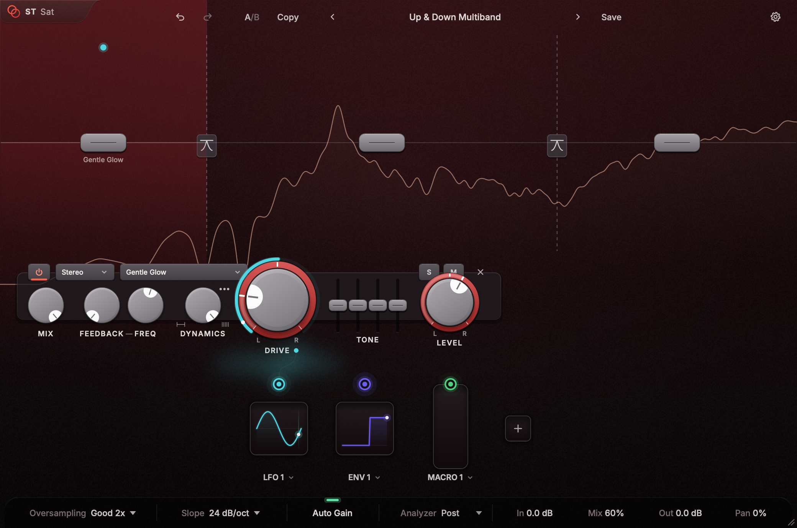

# ST Sat

Multiband saturation with upward + downward dynamics and per-band reverb. VST3 and AU for macOS (Apple Silicon + Intel).
Built on [st-shell](https://github.com/davidstokarski/st-shell).



## Download

**[⬇ Download ST Sat for macOS (VST3 + AU)](https://github.com/davidstokarski/st-sat/releases/latest/download/ST-Sat-macOS.zip)**
— or pick a version on the [Releases page](https://github.com/davidstokarski/st-sat/releases).

The zip contains `ST Sat.vst3` and `ST Sat.component`:

1. Copy `ST Sat.vst3` to `~/Library/Audio/Plug-Ins/VST3/`
2. Copy `ST Sat.component` to `~/Library/Audio/Plug-Ins/Components/`
3. The builds are ad-hoc signed (not notarised). If macOS blocks them, run once:
   ```bash
   xattr -dr com.apple.quarantine ~/Library/Audio/Plug-Ins/VST3/"ST Sat.vst3" ~/Library/Audio/Plug-Ins/Components/"ST Sat.component"
   ```
4. Restart your DAW.

(The repository is private, so the link works when you're signed in to GitHub with access.)

## Features
- Up to 6 bands with phase-coherent Linkwitz–Riley crossovers (12/24/48 dB/oct); drag crossovers and band levels
  right on the spectrum, double-click to add a band
- 27 saturation styles across Tube, Tape, Saturation, Amp, Clip and FX, with loudness-calibrated auto gain
- Per band: Drive (rim = stereo drive spread), Dynamics (upward + downward compression / expansion with thresholds,
  ratios, attack, release, pre/post), resonant Feedback + frequency, 4-band Tone EQ, Mix, Level (rim = pan),
  stereo / mid / side / left / right processing, solo / mute / bypass
- **Space**: per-band reverb with 8 sounds (Room, Chamber, Plate, Hall, Cathedral, Spring, Ambience, Bloom), decay,
  size, pre-delay, tone, width, tail compression and ducking from this band, any band, all bands or the input
- Modulation: LFOs (tempo sync), envelope followers (input or any band), macros — drag a connector onto any knob,
  drag the coloured arc to change depth
- Oversampling 1x–8x (switched safely off the audio thread), global input / mix / output / pan
- Presets, A/B compare, undo/redo, resizable UI, native macOS menus

## Build

Expects `../st-shell` next to this repo (otherwise fetched from GitHub) and JUCE 9.0.5 in `../.st-deps/JUCE-9.0.5`
(otherwise fetched). Command Line Tools are enough.

```bash
cmake -S . -B build -G Ninja -DCMAKE_BUILD_TYPE=Release
cmake --build build
```

Debug builds copy the plugins to `~/Library/Audio/Plug-Ins/{VST3,Components}`. Validate the AU with
`auval -v aufx Stst StAu`.

Tests and UI snapshots:

```bash
cmake -S . -B build -DSTSAT_BUILD_TESTS=ON && cmake --build build
./build/tests/StSatPluginTests_artefacts/Release/StSatPluginTests                     # stress tests
./build/tests/StSatPluginTests_artefacts/Release/StSatPluginTests --snapshot /tmp/snaps  # PNG renders of the UI
./build/tests/StSatDspTests_artefacts/Release/StSatDspTests --test                     # saturation styles
```

## Releasing

```bash
scripts/release.sh
```

Builds a universal binary, zips `ST Sat.vst3` + `ST Sat.component` and publishes/updates the GitHub release for the
version in `CMakeLists.txt` (bump `project(... VERSION x.y.z)` first for a new release).

## Usage tips
- Drag a band's grey handle up/down for its level; drag the dashed-line grips to move crossovers; double-click the
  display to add a band; × on the band bar removes it.
- Drag the red ring of Drive to spread drive between L/R; drag Level's ring to pan.
- `•••` next to Dynamics or Space opens their detail panels.
- Alt-click or double-click resets a knob; cmd-click types a value; shift-drag for fine control.
